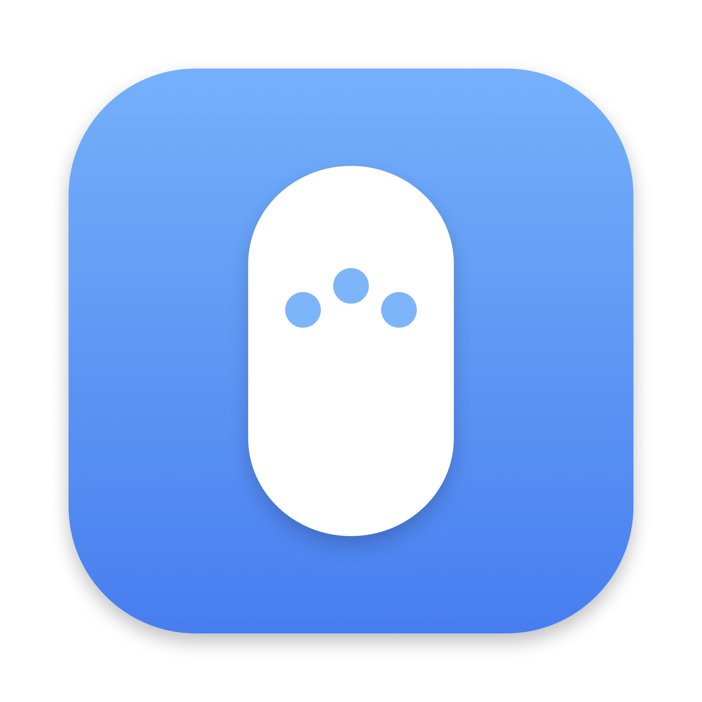
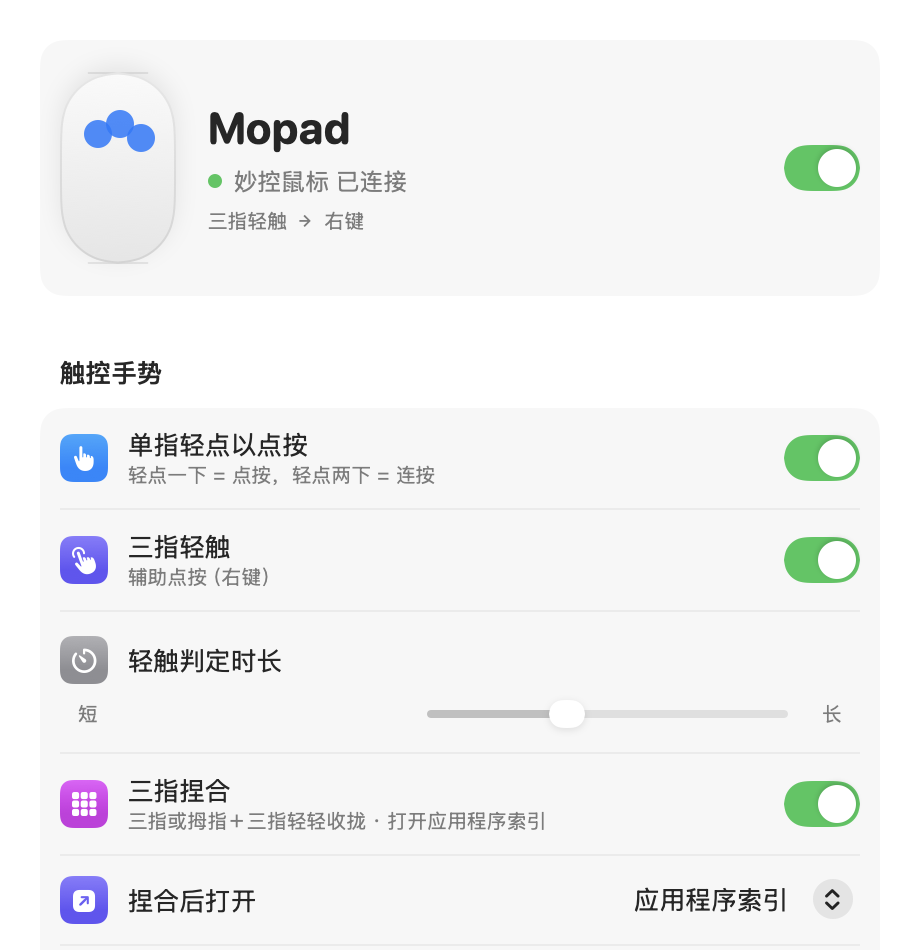
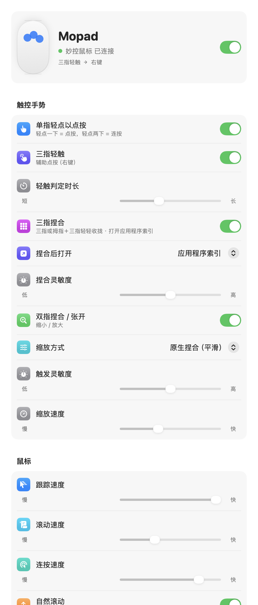

<p align="center">
  
</p>

<h1 align="center">Mopad</h1>

<p align="center">
  让妙控鼠标像触控板一样操作<br>
  <sub>Trackpad-style gestures for Apple Magic Mouse on macOS</sub>
</p>

<p align="center">
  
  
  
  
</p>

<p align="center">
  
</p>

---

## 功能

| 手势 | 动作 | 说明 |
|---|---|---|
| **单指轻点** | 点按 | 轻点两下 = 连按，间隔跟随系统「连按速度」。可单独开关 |
| **三指轻触** | 辅助点按（右键） | 三指同时快速落下并抬起，几乎不移动 |
| **三指捏合** | 打开应用程序索引 | 轻轻收拢即可，接近触控板手感；支持「拇指 + 三指」。也可改为调度中心 / 聚焦搜索 / 显示桌面 |
| **双指捏合 / 张开** | 缩小 / 放大 | 「原生捏合」平滑缩放，或「⌘+ / ⌘−」快捷键模式 |

**系统鼠标设置**：跟踪速度、滚动速度、连按速度、自然滚动、辅助点按、智能缩放、页面轻扫、全屏应用轻扫、调度中心，与「系统设置 › 鼠标」双向同步，修改即时生效。

<details>
<summary>查看完整设置界面</summary>
<p align="center"></p>
</details>

**其他**
- iOS 风格设置界面，顶部实时显示手指在鼠标表面的位置与最近识别的手势
- 常驻菜单栏，可一键启用 / 停用、开关单指轻点
- 登录时自动打开；鼠标断连重连、系统唤醒后自动重新识别设备

### 防误触设计

| 场景 | 处理 |
|---|---|
| 手指一直搭在鼠标上 | 只认「快落快起」的轻点，按住、滑动不触发 |
| 真按下了物理按键 | 物理点击期间的轻点不再重复触发 |
| 移动鼠标 / 滚动页面 | 光标位移或滚动期间的触碰不算点按 |
| 双指缩放 | 缩放期间及抬指后 0.6 秒屏蔽滚动与全屏轻扫，避免页面乱跑 |
| 手指短暂丢失 | 三指捏合允许 0.15 秒内丢指，不中断识别 |

---

## 安装

1. 在 [Releases](../../releases) 下载 `Mopad-x.y.z.dmg`，打开后把 **Mopad** 拖进「应用程序」。
2. 首次打开：需在 Finder 中 **右键 Mopad › 打开**，或在终端执行：
   ```bash
   xattr -dr com.apple.quarantine /Applications/Mopad.app
   ```
3. 授予权限：**系统设置 › 隐私与安全性 › 辅助功能**，打开 Mopad。授权后 Mopad 会自动重启，设置页顶部的「权限」提示消失即表示就绪。

> 若辅助功能列表里 Mopad 已开启却仍提示未授权：选中 Mopad 点「−」移除，再在 Mopad 里点「去授权」重新添加。

### 冲突提示
- 开启「单指轻点以点按」时，建议关闭系统「智能缩放」（单指轻点两下），否则连按会同时触发缩放。设置页会给出一键关闭按钮。
- 若双指缩放时误触切换全屏应用，可关闭「在全屏应用间轻扫」。

## 致谢

思路参考了 [BetterTouchTool](https://folivora.ai/)、[Jitouch](https://github.com/JitouchApp/Jitouch-project)、[MiddleClick](https://github.com/artginzburg/MiddleClick)、[Mac Mouse Fix](https://github.com/noah-nuebling/mac-mouse-fix) 等项目。

## 许可证

[MIT](LICENSE) © 2026 Zeki
